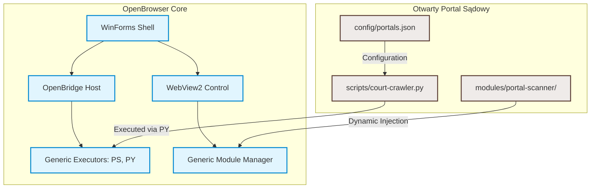

# Plan Separacji Architektonicznej: Otwarty Portal Sądowy

## 1. Cel i Tło
Projekt **OpenBrowser** wraz z protokołem **OpenBridge** stanowi generyczną, bezpieczną platformę uruchomieniową (przeglądarka oparta o WebView2 + mostek wykonawczy PowerShell/Python). 
Z kolei **Otwarty Portal Sądowy** to konkretne zastosowanie biznesowe mające na celu automatyzację pobierania dokumentacji procesowej z Portalu Informacyjnego Sądów Powszechnych (np. portalu wrocławskiego) przy użyciu skryptu `PortalScanner.js` i dedykowanych selektorów DOM.

Obecna implementacja cierpi na silne sprzężenie (coupling) – logika biznesowa skanera sądów jest wbudowana bezpośrednio w kod jądra przeglądarki (`MainForm.cs`, dedykowane przyciski UI, dedykowana klasa `PortalScanner.cs`). 

Niniejszy dokument przedstawia plan pełnego rozdzielenia tych dwóch warstw, co pozwoli na:
* Rozwijanie rdzenia przeglądarki jako stabilnej i uniwersalnej platformy.
* Łatwe aktualizowanie selektorów skanera sądowego (które często ulegają zmianom przy przebudowie stron rządowych) bez konieczności rekompilacji całej aplikacji WinForms.
* Możliwość tworzenia innych dedykowanych "skanerów" i wtyczek przez umieszczenie ich w katalogu `modules/`.

---

## 2. Obecny Stan Sprzężenia (Coupling Audit)

W obecnej architekturze moduł sądowy jest połączony z rdzeniem w następujących punktach:
1. **Interfejs Użytkownika (`MainForm.Designer.cs`):**
   * Przyciski `_navigatePortalButton` (Przejdź do portalu) oraz `_scanPortalButton` (Skanuj portal).
2. **Logika Kontrolera (`MainForm.cs`):**
   * Metoda `NavigateToPortal()`, która ma zahardkodowany URL: `https://portal.wroclaw.sa.gov.pl`.
   * Metoda `ScanPortalAsync()`, która bezpośrednio wstrzykuje `PortalScanner.Script` do WebView2.
3. **Pliki Pomocnicze w Projekcie WinForms:**
   * [PortalScanner.cs](file:///d:/projects/open-browser/releases/BridgeBrowserAlpha0/src/BridgeBrowserAlpha0/PortalScanner.cs) – wczytujący skrypt z dysku.
   * `PortalScanner.js` – zawierający specyficzne selektory CSS i logikę klikania na stronach sądowych.

---

## 3. Docelowy Model Separacji (Decoupled Architecture)

Proponujemy podział na dwa niezależne komponenty:



### A. Rdzeń: Generyczna Platforma (OpenBrowser / OpenBridge)
* **Odpowiedzialność:** Inicjalizacja środowiska WebView2, obsługa logowania/sesji LLM, autoryzacja i wykonywanie poleceń systemowych poprzez OpenBridge, generyczny mechanizm wstrzykiwania modułów użytkownika.
* **UI:** Brak przycisków specyficznych dla sądów. Zamiast tego pasek narzędzi oferuje:
  * Przycisk ładowania zewnętrznych wtyczek/skryptów z katalogu `modules/`.
  * Uniwersalne narzędzie dumpowania DOM (`DomDumper`).

### B. Moduł: Otwarty Portal Sądowy (Zewnętrzny Komponent)
* **Odpowiedzialność:** Przechodzenie po strukturze Portalu Informacyjnego Sądów Powszechnych, logowanie (opcjonalnie z bezpiecznego pliku konfiguracyjnego `config/local/`), detekcja spraw sądowych, wyodrębnianie pism i pobieranie dokumentacji.
* **Format:** Moduł ten może być zaimplementowany na dwa sposoby:
  1. **Dynamiczny skrypt wstrzykiwany (JS Module):** Umieszczony w katalogu `modules/portal-scanner/current/portal-scanner.js` i rejestrowany w `modules-index_new.md`. Model lub użytkownik może zażądać jego załadowania i wykonania.
  2. **Skrypt automatyzacji (Python Crawler):** Uruchamiany lokalnie przez mostek OpenBridge `PY`, sterujący przeglądarką poprzez API WebView2 lub bezpośrednio realizujący requests/scraping, jeśli sesja jest współdzielona.

---

## 4. Krok po Kroku: Plan Migracji

### Krok 1: Przeniesienie specyficznych zasobów do modułów zewnętrznych
* Przeniesienie `PortalScanner.js` do lokalizacji zewnętrznej, np. `modules/court-portal-scanner/portal-scanner.js`.
* Dodanie odpowiedniego wpisu do rejestru modułów `docs/runtime/modules-index_new.md` (zgodnie z `INV-REG-001`).

### Krok 2: Usunięcie dedykowanych przycisków i metod z MainForm
* Usunięcie przycisków `_navigatePortalButton` oraz `_scanPortalButton` z formularza i jego pliku projektowego.
* Usunięcie powiązanych metod z `MainForm.cs`.

### Krok 3: Wprowadzenie generycznej zakładki/menu Modułów w UI
* Dodanie w UI listy rozwijanej (ComboBox) lub prostego panelu dynamicznie wczytującego dostępne wtyczki z katalogu `modules/`.
* Kliknięcie generycznego przycisku "Uruchom moduł" załaduje powiązany plik `.js` i wstrzyknie go do aktywnej karty WebView.

### Krok 4: Implementacja kontroli parametryzowanej przez konfigurację JSON
* Stworzenie uniwersalnego pliku konfiguracyjnego `config/court-targets.json` o strukturze:
  ```json
  {
    "default_portal": "https://portal.wroclaw.sa.gov.pl",
    "selectors": {
      "document_row": ".document-row-class",
      "download_button": "a[href*='download']"
    }
  }
  ```
  Dzięki temu aktualizacje selektorów będą polegały wyłącznie na edycji pliku JSON, a nie na zmianie kodu aplikacji WinForms.

---

## 5. Korzyści z Separacji
1. **Stabilność Core'a:** Zmiana układu graficznego rządowych portali sądowych nie wpływa na stabilność i bezpieczeństwo kodu jądra przeglądarki.
2. **Możliwość Rozbudowy:** Łatwe dodawanie wsparcia dla portali innych apelacji (np. Warszawskiej, Poznańskiej) poprzez proste dodanie nowych reguł w pliku konfiguracyjnym lub napisanie dedykowanego pod-modułu JS.
3. **Redukcja Szumu Kontekstowego:** Modele programistyczne pracujące nad rdzeniem nie będą obciążane czytaniem specyficznych reguł domenowych związanych z polskim sądownictwem powszechnym.
